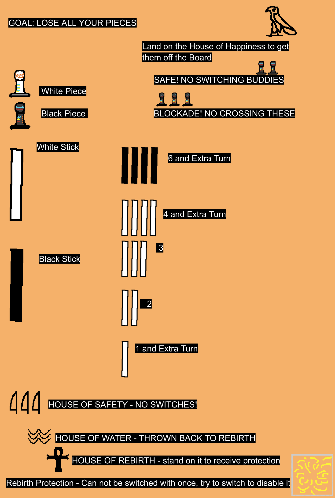

# Senet-Boom
Ancient egyptian board game. LibGDX based. Simple Version.

**[Play in your browser on itch.io](https://gardeningcat.itch.io/senet-boom)**

Run on desktop: `./gradlew :desktop:run` · Build for the web: `./gradlew :teavm:buildJavaScript` (output in `teavm/build/dist/webapp`)

